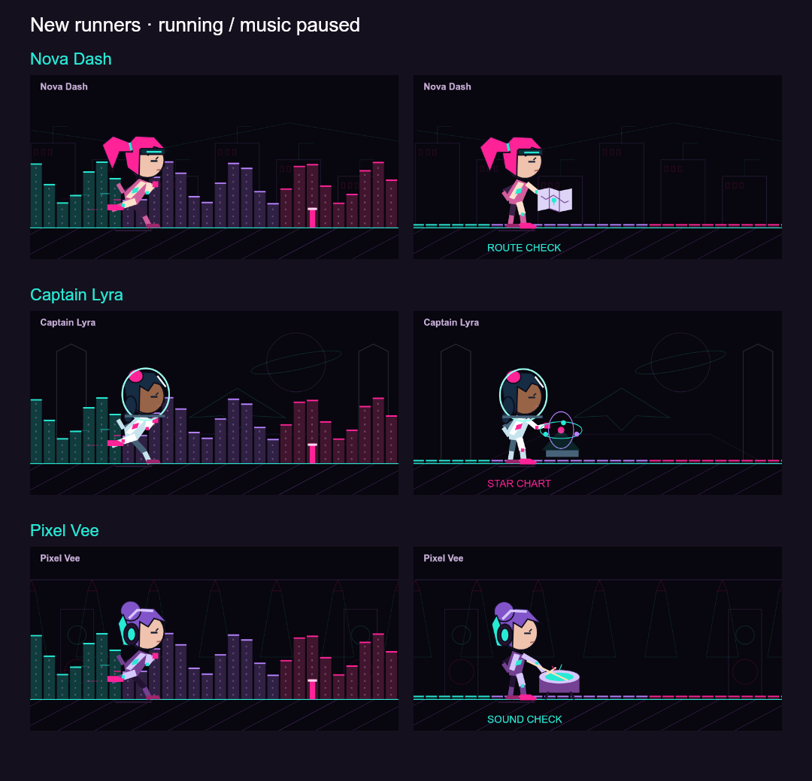

# MusicThing

[Releases](https://github.com/HyperXcess/MusicThing/releases) · [Issues](https://github.com/HyperXcess/MusicThing/issues)

**Retrowave visualizers, animated runners and live lyrics for your Car Thing.**

Five audio-reactive effects fill the screen: **EQ Bars**, **Warp Tunnel**, **Synth Grid**, **Spectrum Waves**, and **Beat Runner**. Beat Runner has seventeen characters, moving vector environments, an EQ skyline, bass-triggered hurdles, and a different rest animation for each character when music stops. No audio recordings are saved.



## Requirements

Tested on an Apple Silicon Mac running macOS 13+, DeskThing Server **0.11.17**, client **0.11.2**, and a Thing Labs-flashed Car Thing. Windows, Linux and Intel Mac audio capture are not supported by this release. The optional client integrations validate the exact 0.11.2 modern and legacy bundle layouts before writing. An upstream client update may require reinstalling a compatible integration.

Install and sign in to DeskThing's **Spotify app** first. Music must play through the Mac's audio output for the visualizer to respond; playback only on a phone or another Spotify speaker is not captured. Allow DeskThing under macOS **Privacy & Security → Screen & System Audio Recording** when prompted, then reopen DeskThing if required. The helper receives audio only; no screen images are transmitted to the Car Thing.

## Install

1. In DeskThing, open **Downloads → Add Client/App** in the left sidebar.
2. Add `https://github.com/HyperXcess/MusicThing` as an **App** repository, then pull/download the latest release and initialize it.
3. The declared post-install helper backs up and stages MusicThing navigation and the Spotify visualizer integration. Spotify must already be installed. It does not modify Spotify credentials or calendar settings.
4. Open **Clients → Push staged client**, then **Restart Chromium on the Device**.
5. Open MusicThing from your app launcher. Audio capture starts automatically.

The `musicthing-vVERSION.zip` asset is the installable app. `latest.json` provides store metadata, the version-pinned runtime URL, embedded icon, size, and SHA-512. `MusicThing-source-vVERSION.zip` is development source.

[LaunchThing](https://github.com/HyperXcess/LaunchThing) and [ControlThing](https://github.com/HyperXcess/ControlThing) are optional companions. ControlThing adds the bottom waveform entry: tap it or pull up from the bottom edge to open MusicThing. The entry disappears inside MusicThing; **Back** returns to your previous app. A short pull previews and cancels. Without ControlThing, use your app launcher.

## Controls

- **Swipe left/right on visuals**, or turn the dial, to cycle effects. Selection is shared with Spotify's original screen, including after leaving fullscreen.
- **Swipe up/down** to change audio sensitivity (default 1.0×). In Beat Runner this changes running speed instead. **More → Adjust** separates running speed from EQ skyline sensitivity.
- **Tap anywhere on Beat Runner** to cycle its seventeen characters. Each has a distinct environment and silence animation. New female runners include Nova Dash (courier with a route map), Captain Lyra (pilot with a floating star chart), and Pixel Vee (drummer with a sound-check break). Hurdles are triggered by bass changes and travel toward the runner; this is not exact beat-grid synchronization.
- **Expand** hides the player row. Tap other visual effects to restore controls, or use the lower-left **↙** control; the latter also works for Beat Runner, whose taps cycle characters.
- **More** contains the effect picker, Pause/Resume visuals, Adjust, Lyrics, Up Next, Recent and Devices. Swiping a visualizer changes effects, never these pages.
- **♫ Lyrics**, beneath the runner name, toggles an optional upper-right lyric overlay. The current line uses small regular text; the next line is dimmer. No text background. Preference persists across the two visualizer views and fullscreen.

On the original Spotify screen, swipe sideways to cycle artwork and effects. Swipe up on artwork to show EQ Bars. The native Spotify playback controls remain available above the visualizer. Up/down over an effect changes sensitivity or runner speed. MusicThing's own view uses one compact player row; it suppresses the duplicate native mini-player.

## Lyrics and Spotify permissions

Timed lyrics from **LRCLIB** highlight and follow playback on the Lyrics page; manual scrolling exposes **Follow live**. Some recordings have only plain lyrics, and some have none. The visualizer overlay requires timed lyrics and reports when unavailable. Track title, artist, album and duration are sent to LRCLIB to find a match. No Spotify token is sent to LRCLIB or the browser.

Up Next shows the Spotify queue with playback/queue actions. Devices lists Spotify Connect speakers. Recent requires Spotify's `user-read-recently-played` permission; if the installed Spotify integration has not requested that scope, Spotify returns an error until its authorization is updated. This app does not silently grant new scopes.

The backend reuses the existing local DeskThing Spotify integration's token and sends it only to Spotify's API. It does not provide a separate OAuth flow. **Music videos are not supported on the tested Car Thing browser**, which lacks the protected-playback support Spotify requires. Experimental embed code is not exposed in navigation.

## Optional legacy HTTPS relay

The release defaults **Enable legacy Spotify HTTPS relay** to off. It is only for devices already configured to use a Spotify-only USB proxy; initialization does not change firmware, proxy settings or the browser supervisor command. Enabling it starts a loopback-only Mac relay, restores port 8892 for one connected device and synchronizes its clock. Only allowlisted Spotify HTTPS destinations are accepted; TLS and certificate validation remain intact. This does not make protected Spotify video work. Normal audio visuals and lyrics do not require this relay.

## Build, test and package

On Apple Silicon/macOS, install Node.js 20+ and Apple's Command Line Tools:

```sh
npm ci
npm test
npm run package
```

The build compiles the Swift ScreenCaptureKit helper and bundles client/server code for Chromium 69/Node 20. Release files are in `release/`. For a manual integration, build, then run `node dist/postinstall.mjs --host "/path/to/deskthing"` with DeskThing closed; push the staged client afterward.

Post-install changes have `.musicthing.backup` files. Restore these with DeskThing closed, then push/restart the client to undo the integration. A full-bundle backup can include older companion versions; reapply other extensions afterward. Reinstalling or updating Spotify can replace its client integration; reinitialize MusicThing to restore it.

## License

MIT. See [THIRD_PARTY_NOTICES.md](THIRD_PARTY_NOTICES.md) for dependency credits and licenses. Not an official Spotify or DeskThing product.
