# Visual guide

Visualizer screenshots show app rendering. The updated Beat Fighter screenshot is captured from Car Thing; the fighter design strip and object atlases show the approved source artwork. Still images cannot show animation or live audio response.

## EQ Bars

A clean frequency meter with teal, purple and pink bars.

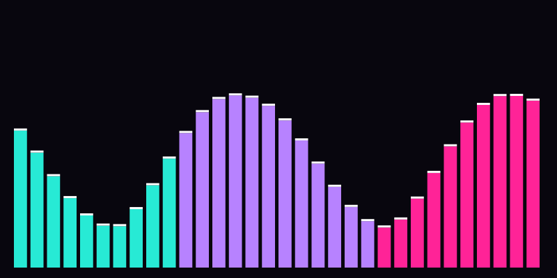

## Warp Tunnel

Audio-reactive tunnel rings; WebGL feedback is used when available, with a canvas fallback. The screenshot shows the canvas fallback.

## Synth Grid

An anchored perspective grid with audio-driven peaks. Sensitivity changes peak height.

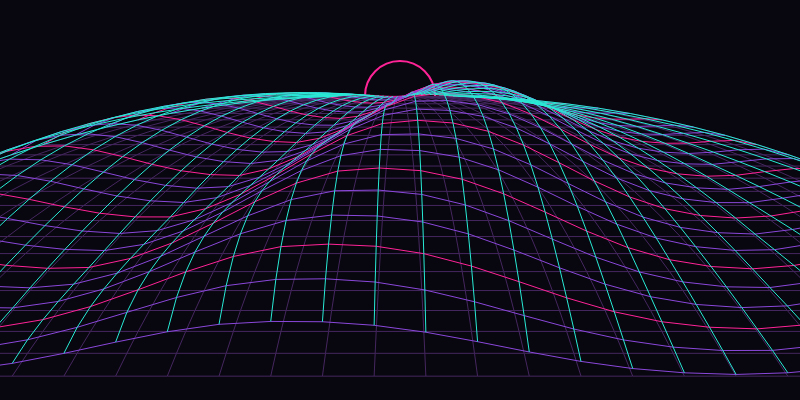

## Spectrum Waves

Three independently reacting overlapping curves: solid teal, dashed purple and dotted pink.

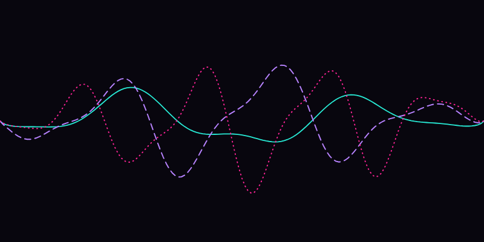

## Neon Stage

Mirrored frequency bars. DJ scenes retain their stage lighting.

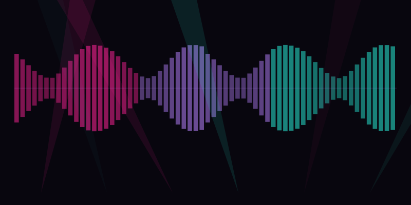

## Beat Runner

Seventeen runners with individual bodies, reactive hurdles, an EQ skyline and quiet activities.

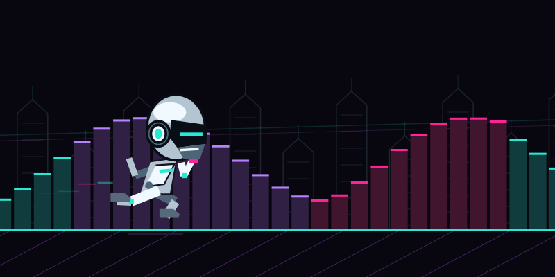

## Beat Fighter

Planted martial artists with varied target heights, strikes and evasions; live Spectrum Waves behind them.

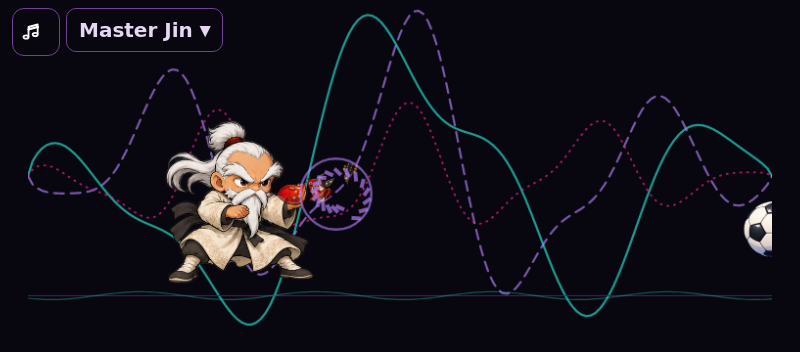

## Beat DJ

Twenty-five selectable DJ scenes, including shared-table Chrome & Gold, Guest Set and Dance Party.

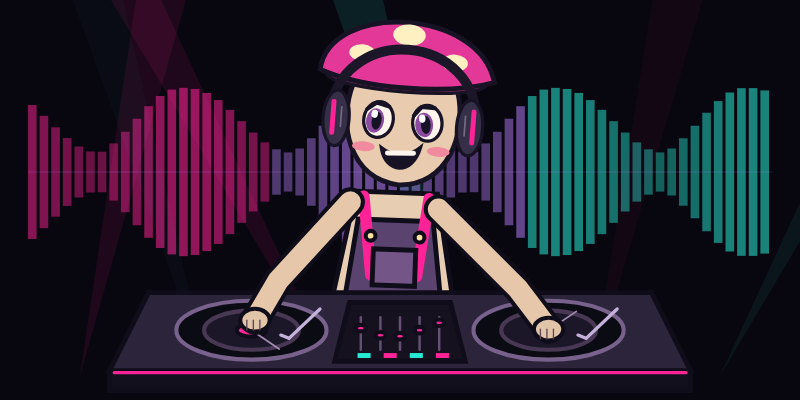

## Runner collection

Tap the picture to cycle, or tap the name to open the compact dropdown. Every runner has an individual body, environment and pause activity.

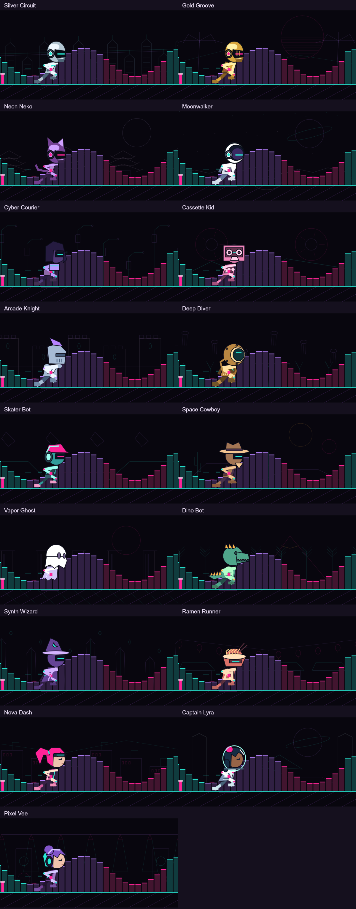

## Fighter collection

Master Jin, Iron Monk, Jade Lotus, Ember Fox, Chrome Fist and The Bride. Distinct outfits and targets; no scrolling ground or static arena scenery.

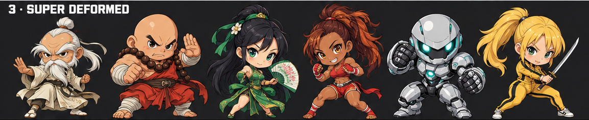

## DJ collection

The gallery follows the alphabetical picker order, with Guest Set and Dance Party last. Tap the picture to cycle without opening a menu. The music-note button toggles lyrics independently.

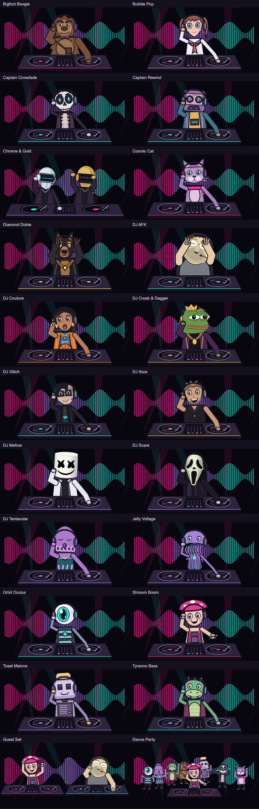

## When the music stops

Characters settle into individual quiet activities after silence is detected, then return to performance when captured audio resumes. These galleries show quiet-mode artwork.

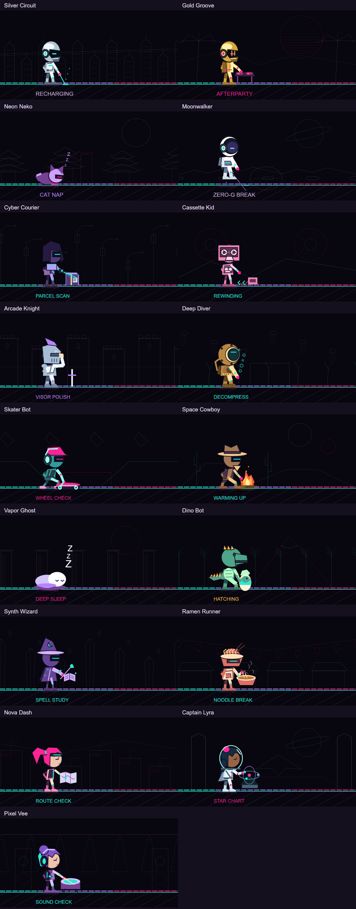

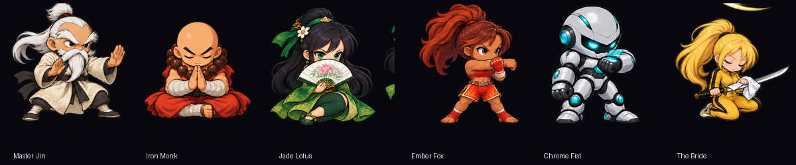

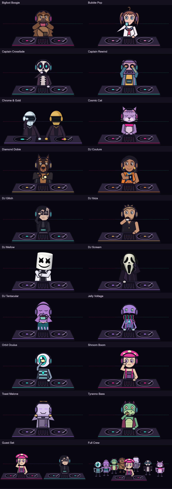

## New arrivals: Deadpan, Zest and Chiseled

Deadpan takes a coffee break, Zest reads joke notes and Chiseled admires his jaw in a mirror. All three join Guest Set and Dance Party.

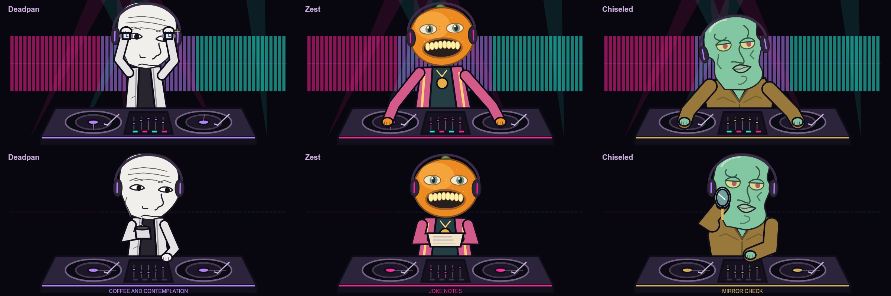

## New arrivals: royal frog and gamer

Croak & Dagger uses the chosen crown-and-chain design, with a three-quarter frog face. AFK has a broad gray-and-black shirt, glasses, sparse scruffy hair, stubble and a broad slouched body. Both join the rotating Guest Set and Dance Party cast.

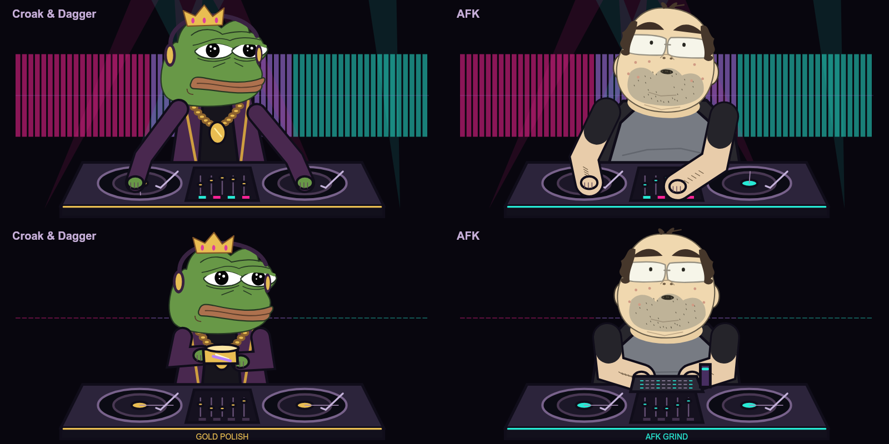

## Chrome & Gold: five additional set animations

Headphone check, crossfader sweep, double scratch, overhead clap and robot wave. Gestures blend in and out; the existing mixing/hype role exchange continues. Both robots share one table. Quiet mode returns to visor polishing and standby.

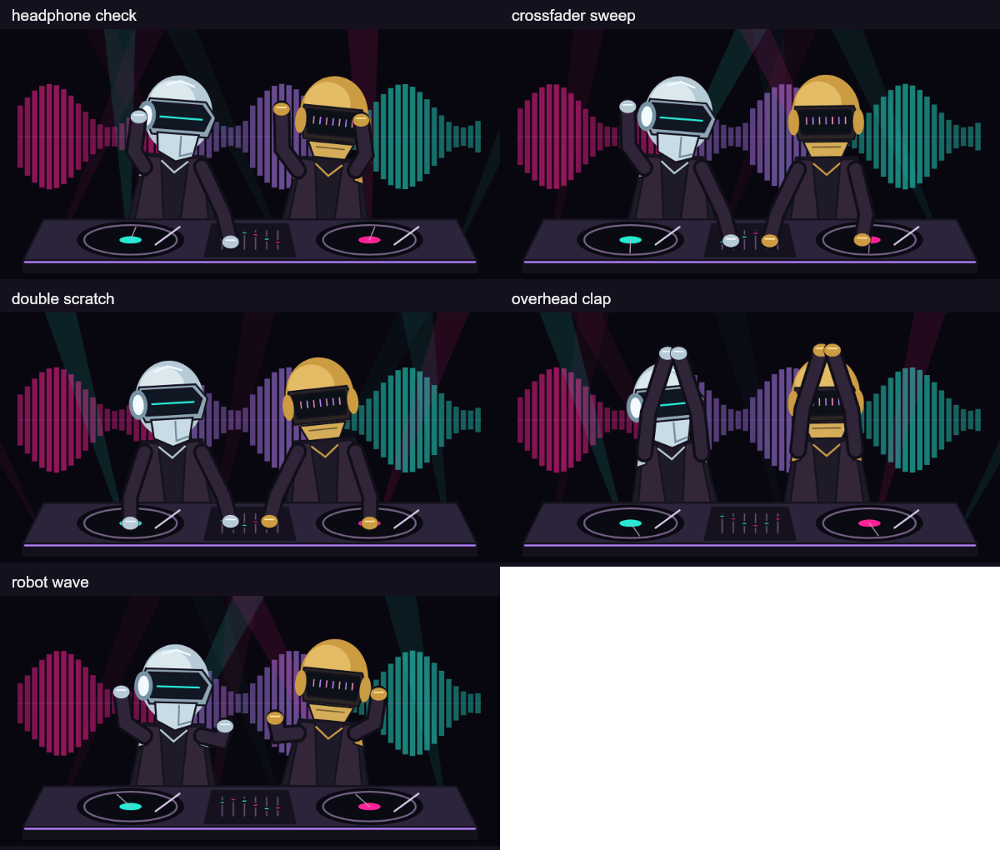

## Lyrics and navigation

Use the music-note icon to toggle the upper-right current/next-line overlay. Tap the character name for a small scrollable dropdown; the animation continues behind it. Left/right swipes change effects, vertical swipes adjust the current character mode’s pace, and More opens Spotify companion pages. Pace is saved separately for Runner, Fighter and DJ. Timed lyrics depend on LRCLIB availability.

For installation, audio permissions, Spotify permissions and recovery instructions, return to the [README](../README.md).

## Updated Beat Fighter cast

Master Jin, Iron Monk, Jade Lotus, Ember Fox, Chrome Fist and The Bride use illustrated super-deformed animation poses. The design strip below is source artwork; the Beat Fighter screenshot above shows device rendering. The quiet-mode strip shows the current illustrated resting poses.

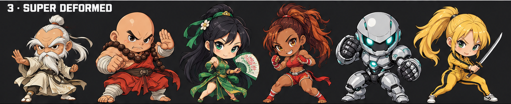

## Fifty interactive objects

Each shuffled bag contains all fifty objects once. Reactions include illustrated fragments, sliced halves, launches, bounces, spills, spring rebounds, nesting dolls, a portal, a swinging wrecking ball and cascading dominoes. Actions are visual and do not change Spotify playback.

### Objects 1–10

Arcade cabinets, Cassette tapes, Vinyl records, Boomboxes, Disco balls, Headphones, Speaker towers, Guitars, Drum kits, Microphone stands.

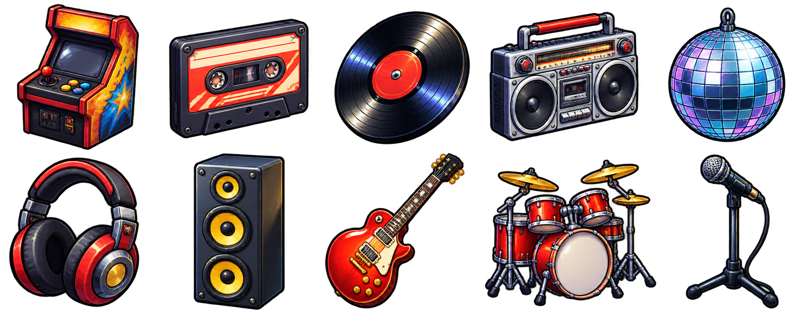

### Objects 11–20

Training dummies, Crates, Brick stacks, Ice blocks, Watermelons, Pumpkins, Sushi rolls, Ramen bowls, Soda cans, Popcorn machines.

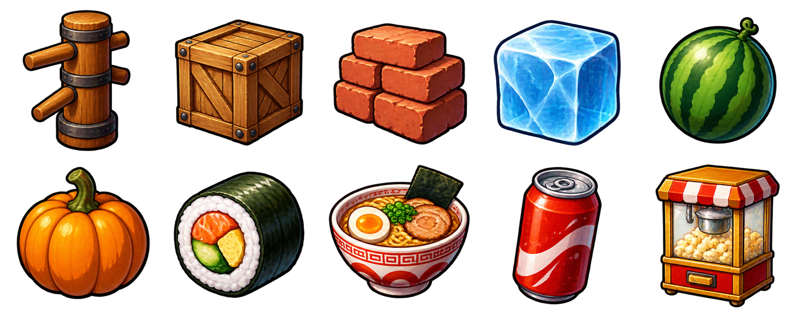

### Objects 21–30

Bowling balls, Basketballs, Soccer balls, Pinball bumpers, Dice, Slot machines, Treasure chests, Piggy banks, Gem clusters, Alarm clocks.

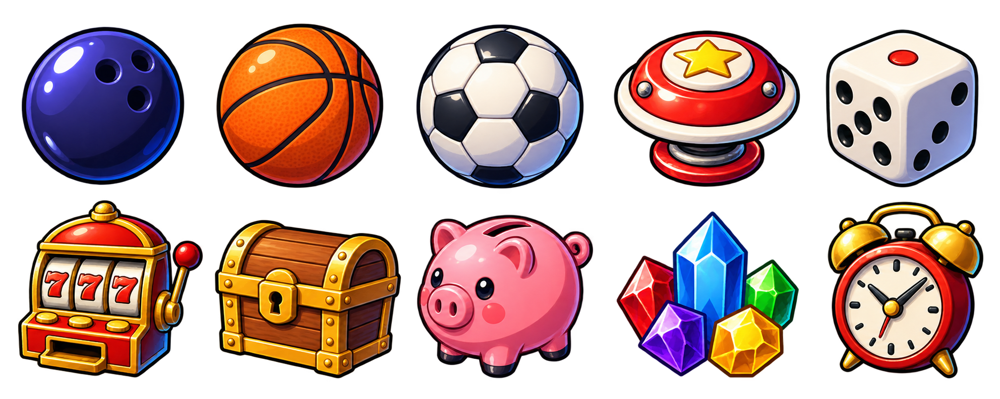

### Objects 31–40

Wind-up robots, Toy tanks, Flying saucers, Rockets, Mechanical spiders, Floating eyeballs, Angry clouds, Meteorites, Ringed planets, Black-hole orbs.

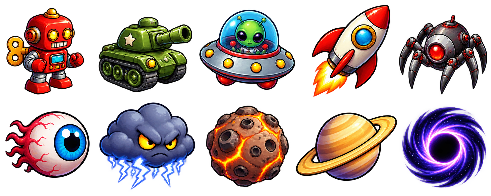

### Objects 41–50

Rubber ducks, Punching clowns, Piñatas, Nesting dolls, Jack-in-the-boxes, Bubblegum bubbles, Mystery doors, Vending machines, Wrecking balls, Domino chains.

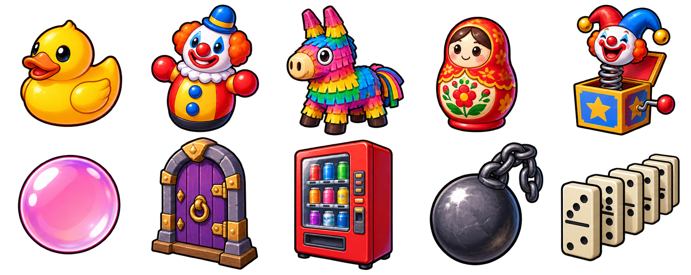
